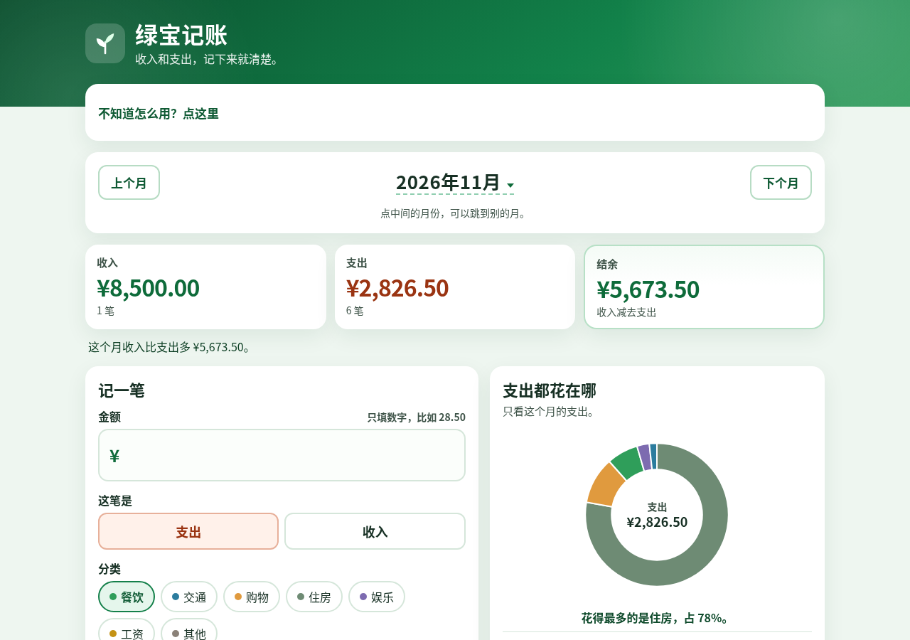
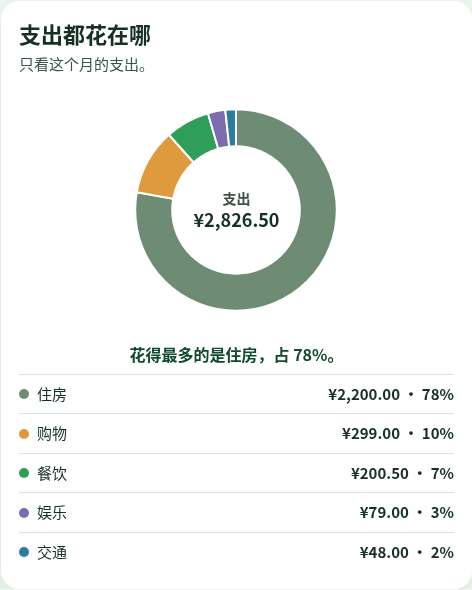

# 绿宝记账 · Lvbao Ledger

> 一个简单好用的网页记账本，打开就能用，不用注册，不用安装。
> A simple web-based expense tracker. Just open it and start recording — no sign-up, no installation.

**在线打开 / Open online：** [https://812822586-droid.github.io/lvbao-jizhang/](https://812822586-droid.github.io/lvbao-jizhang/)

---

## 截图 / Screenshots

截图使用虚构示例数据（2026年11月），不是个人真实账目。 / Screenshots use fictional sample records (November 2026), not personal financial data.

---

## 中文说明

### 项目简介

绿宝记账是一个只有一个网页文件的记账工具。用它可以把每天的收入和支出记下来，月底一眼看清钱花在了哪里。所有数据只保存在你自己电脑的浏览器里，不会上传到任何服务器。

### 功能

- **记一笔**：选择「支出」或「收入」，填写金额、日期、分类和备注（备注可以不填）。
- **分类**：内置餐饮、交通、购物、住房、娱乐、工资、其他七个分类，每个分类有自己的颜色。
- **按月查看**：用「上个月」「下个月」切换月份，点「回到本月」回到当前月份。
- **月度汇总**：自动算出本月的收入、支出和结余（结余 = 收入 − 支出）。
- **支出都花在哪**：用图表显示本月各分类的支出占比。
- **明细**：列出本月每一笔记录，可以修改或删除。
- **导出表格**：把记录导出成 CSV 表格，能用 Excel 或 WPS 打开。
- **备份与恢复**：「导出备份」保存一个备份文件，「从备份恢复」可以把数据找回来，换电脑也能用。
- **本地保存**：数据存在浏览器里，关掉网页再打开，记录还在。

### 怎么用（新手版）

**方法一：在线打开（推荐）**

1. 点上面的「在线打开」链接。
2. 浏览器会直接打开记账页面，就可以开始记账了。
3. 想以后快速打开，可以按 `Ctrl + D` 把它加入浏览器收藏夹。

**方法二：下载到电脑上用**

1. 在本页面上方点绿色的 **Code** 按钮，再点 **Download ZIP**。
2. 找到下载的压缩包（一般在「下载」文件夹），右键选择「全部解压缩」。
3. 打开解压出来的文件夹，双击 `index.html`，浏览器就会打开记账页面。

**记一笔账**

1. 点「支出」或「收入」。
2. 填写金额，选择哪一天（默认今天），点一个分类。
3. 备注可以写「午饭」「地铁」之类，也可以不写。
4. 点「记下来」，这笔账就出现在下面的明细里了。

**小提醒**

- 数据只保存在当前电脑的当前浏览器里。换浏览器、换电脑，或者清理浏览器数据，记录可能会看不到。
- 建议每个月点一次「导出备份」，把备份文件存好。需要时点「从备份恢复」就能找回。

### 开源许可

本项目采用 [MIT 许可证](LICENSE)，可以免费使用、修改和分享。

---

## English

### About

Lvbao Ledger is a bookkeeping tool contained in a single web page. Record your daily income and expenses, and see at a glance where your money went each month. All data stays in your own browser on your own computer — nothing is uploaded to any server.

### Features

- **Add a record**: choose Expense or Income, then enter the amount, date, category, and an optional note.
- **Categories**: seven built-in categories (Dining, Transport, Shopping, Housing, Entertainment, Salary, Other), each with its own color.
- **Monthly view**: switch months with Previous / Next, and jump back to the current month in one click.
- **Monthly summary**: income, expenses, and balance (income − expenses) are calculated automatically.
- **Where the money went**: a chart shows how this month's spending splits across categories.
- **Details**: every record for the month is listed and can be edited or deleted.
- **Export to spreadsheet**: export records as a CSV file that opens in Excel or WPS.
- **Backup & restore**: save a backup file and restore it later, even on another computer.
- **Saved locally**: data is stored in the browser, so your records are still there next time you open the page.

### How to use

**Option 1: Open online (recommended)**

1. Click the "Open online" link at the top.
2. The ledger opens in your browser and is ready to use.
3. Press `Ctrl + D` to bookmark it for quick access.

**Option 2: Use it offline**

1. Click the green **Code** button at the top of this page, then **Download ZIP**.
2. Find the ZIP file (usually in your Downloads folder), right-click it, and choose "Extract All".
3. Open the extracted folder and double-click `index.html`.

**Adding a record**

1. Choose Expense or Income.
2. Enter the amount, pick the date (today by default), and tap a category.
3. Optionally add a note such as "lunch" or "subway".
4. Click 记下来 (Save). The record appears in the details list below.

**Tips**

- Data is saved only in the current browser on the current computer. Switching browsers or computers, or clearing browser data, may hide your records.
- Export a backup once a month and keep the file safe. Use "Restore from backup" to bring your data back.

### License

Released under the [MIT License](LICENSE). Free to use, modify, and share.

---

## 微信小程序

微信小程序（第一版）的代码在 [`miniapp/`](miniapp/) 目录，包含原生小程序页面和微信云开发云函数。安装步骤、试玩清单和说明见 [miniapp/README.md](miniapp/README.md)。
